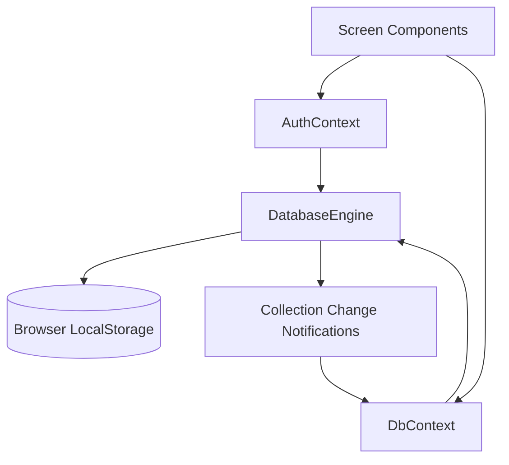
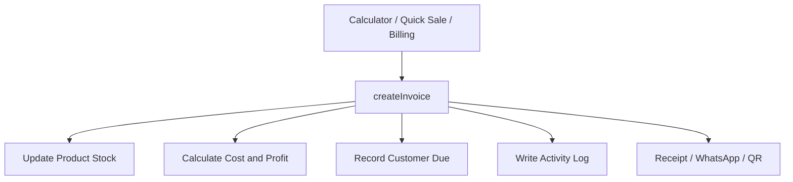

# 🏪 SmartBiz — Calculator & Business Management

<p align="center">
  <strong>A Practical Point-of-Sale & Small Business Management Application</strong>
  <br />
  Simplifying daily sales, inventory, customer credit, expenses, and business reporting.
</p>

<p align="center">
  
  
  
  
  
</p>

<p align="center">
  
  
  
</p>

---

## 📑 Table of Contents

* [📌 Overview](#-overview)
* [✨ Features](#-features)
* [🖥️ Screenshots and Demo](#️-screenshots-and-demo)
* [🛠️ Technology Stack](#️-technology-stack)
* [🏗️ Architecture and Workflow](#️-architecture-and-workflow)
* [📂 Project Structure](#-project-structure)
* [📋 Prerequisites](#-prerequisites)
* [🚀 Installation and Setup](#-installation-and-setup)
* [🔐 Environment Variables and Configuration](#-environment-variables-and-configuration)
* [▶️ Running the Application](#️-running-the-application)
* [📖 Usage Guide](#-usage-guide)
* [💾 Data and Persistence](#-data-and-persistence)
* [👤 Roles and Permissions](#-roles-and-permissions)
* [🛡️ Security and Privacy](#️-security-and-privacy)
* [🧪 Testing and Code Quality](#-testing-and-code-quality)
* [☁️ Deployment](#️-deployment)
* [🔧 Troubleshooting](#-troubleshooting)
* [⚠️ Current Status and Limitations](#️-current-status-and-limitations)
* [🗺️ Roadmap](#️-roadmap)
* [📚 Additional Documentation](#-additional-documentation)
* [🤝 Contributing](#-contributing)
* [📄 License](#-license)
* [👨‍💻 Developer](#-developer)

---

## 📌 Overview

**SmartBiz Calculator & Business Management** is a browser-based, single-page application designed to simplify everyday operations for shopkeepers and small retail businesses.

Traditional small businesses often rely on separate calculators, paper-based credit registers, stock books, and manual expense records. SmartBiz brings these workflows together in one interface.

With SmartBiz, users can:

* 🧮 Perform business calculations, markup calculations, and GST operations.
* 🧾 Create bills and manage point-of-sale transactions.
* 👥 Maintain customer records and track outstanding *Udhar* balances.
* 📦 Manage products, inventory, and stock adjustments.
* 🚚 Record supplier purchases.
* ↩️ Process sales returns.
* 💰 Track operating expenses.
* 📊 Review business summaries, profit and loss, and outstanding balances.
* 💾 Export and restore supported business data using JSON backups.

**Intended users:** Shopkeepers and small retail businesses, particularly those following Pakistani retail conventions.

The default demo data uses Pakistani Rupees (PKR), *Udhar* terminology, and WhatsApp/EasyPaisa-related payment conventions.

> **Project status:** Working frontend prototype with seeded demo data. All application data is stored in the browser. Backend services, cloud synchronization, production-ready authentication, and automated tests are not implemented.

## ✨ Features

### 🧮 1. Smart Business Calculator

The Smart Calculator provides everyday arithmetic and retail calculation tools.

* Standard arithmetic with keyboard and on-screen input.
* Markup (MU) calculations.
* GST addition and removal with a configurable rate.
* Memory functions: M+, M−, and MRC.
* Grand Total (GT) recall.
* Calculation history with category tags.
* Favorites, search, and category filtering.
* Favorite products shortcut bar.
* Convert a calculation into a bill.
* Save a calculation to a customer through the Billing workflow.

### 🧾 2. Quick Sale & Point of Sale

SmartBiz supports quick checkout as well as detailed billing.

**Quick Sale**

* Single-screen checkout for walk-in customers.
* Payment method selection.
* Quick transaction entry.

**Billing / POS**

* Multi-item shopping cart.
* Product search by name, SKU, or barcode text.
* Per-item and bill-level discounts.
* Configurable tax rate.
* Customer selection.
* Paid amount entry.
* Automatic `paid`, `partial`, or `unpaid` invoice status.
* Invoice list with status filtering.

Supported payment methods in the data model include:

* Cash
* Card
* QR-based payment
* Bank transfer
* Credit

### 🧾 3. Printable Receipts & Sharing

* Generate printable receipts through the browser print dialog.
* Choose 58 mm, 80 mm, or A4 receipt paper in Settings.
* Share receipt information through a WhatsApp link.
* Generate QR payment images using the configured payment identifier.
* Configure the store's invoice prefix and receipt footer.

Invoice numbers follow the configured prefix and count-based numbering scheme. The default prefix is `SB-`.

### 👥 4. Customer Management & Udhar Ledger

Keep customer information and credit transactions organized.

* Customer directory and records.
* Outstanding balance tracking.
* Customer ledger entries.
* Payment settlement.
* Credit sale tracking.
* WhatsApp payment reminder links.

These features are particularly useful for small shops that allow customers to pay later.

### 📦 5. Products & Inventory Management

Manage product information and available stock.

* Product name and SKU.
* Barcode field.
* Unit and category.
* Purchase, retail, wholesale, and special prices.
* Available stock and minimum stock levels.
* Product tax rate.
* Favorite product flag.
* Stock adjustment transactions.
* Damaged-stock write-off reason.

### 🚚 6. Supplier & Purchase Management

* Maintain supplier records.
* Create and manage purchase records.
* Record supplier purchases.
* Update product stock through purchase workflows.
* Review supplier-related business information.

### ↩️ 7. Sales Returns

* Process supported sale return workflows.
* Choose whether returned stock is restocked.
* Select a cash refund or credit adjustment.
* Maintain return-related records.

### 💰 8. Expense Management

* Record business expenses.
* Organize expenses by category.
* Review operating expense information.
* Include supported expense data in business reporting.

### 📊 9. Dashboard & Business Reports

The dashboard and reporting screens help users review business activity.

Available reporting features include:

* Dashboard key performance indicators.
* Seven-day area chart.
* Pie chart visualization.
* Profit and Loss report.
* Daily business summary.
* Customer dues report.
* Supplier dues report.
* Best-selling products report.
* Cashier performance report.
* CSV export.
* Print support for reports.

Reports reflect the data currently stored in the application; they are not backed by a centralized server.

### ⚙️ 10. Settings & Data Management

* Store profile configuration.
* Currency settings.
* Invoice prefix.
* Receipt footer.
* Receipt paper size.
* Payment identifier.
* Sound feedback toggle.
* Staff list interface.
* JSON backup export and restore.
* Activity log entries for key transactions.

The application can also use the browser Web Audio API to provide synthesized sound feedback.

## 🖥️ Screenshots and Demo

Screenshots and a live demo URL have not been provided for this repository.

To document the interface, add screenshots to a folder such as `docs/screenshots/` and reference them here.

Suggested screenshots:

| Screenshot              | Suggested file                    |
| ----------------------- | --------------------------------- |
| Dashboard               | `docs/screenshots/dashboard.png`  |
| Smart Calculator        | `docs/screenshots/calculator.png` |
| Billing / POS           | `docs/screenshots/billing.png`    |
| Customer & Udhar Ledger | `docs/screenshots/customers.png`  |
| Inventory               | `docs/screenshots/inventory.png`  |
| Business Reports        | `docs/screenshots/reports.png`    |

Once the files exist, display them using standard Markdown image syntax.

## 🛠️ Technology Stack

| Category           | Technology           | Purpose                                  |
| ------------------ | -------------------- | ---------------------------------------- |
| Language           | TypeScript           | Type-safe application development        |
| UI Library         | React 19             | Component-based interface                |
| Build Tool         | Vite                 | Development server and production builds |
| Styling            | Tailwind CSS 4       | Application styling                      |
| Icons              | Lucide React         | Interface icons                          |
| Charts             | Recharts             | Dashboard visualizations                 |
| Data Persistence   | Browser LocalStorage | Local data storage                       |
| Browser APIs       | Web Audio API        | Optional sound feedback                  |
| Printing           | `window.print()`     | Receipt and report printing              |
| Sharing            | WhatsApp links       | Receipt sharing and reminders            |
| Package Management | npm / Bun            | Dependency installation                  |

### 📦 Dependencies Worth Reviewing

The following dependencies are declared but are not imported by the application's `src/` files according to the supplied project review:

* `@google/genai`
* `express`
* `dotenv`
* `motion`

They may be reserved for future development or removable after confirming that no external scripts or configuration require them.

The current application does not call Gemini or run an Express backend.

## 🏗️ Architecture and Workflow

SmartBiz currently follows a client-side React architecture.

Screen components interact with context providers. The database engine manages browser LocalStorage operations and notifies subscribers when collections change.

### Application Architecture



### Sales Transaction Workflow

The invoice creation workflow coordinates supported business operations.



### Core Data Operations

The database engine in `src/services/db.ts` includes transaction-related methods such as:

* `createInvoice`
* `recordCustomerPayment`
* `createPurchase`
* `processReturn`
* `adjustStock`

Data management helpers include:

* `exportBackup`
* `importBackup`
* `resetToDefaults`

These methods operate on local browser data rather than a remote database.

## 📂 Project Structure

The main application files are organized by feature.

```text
SmartBiz/
├── index.html
├── package.json
├── vite.config.ts
├── tsconfig.json
├── bun.lock
├── metadata.json
├── .env.example
├── public/
│   └── assets/
│       └── aistudio/
└── src/
    ├── main.tsx
    ├── App.tsx
    ├── index.css
    ├── types/
    │   └── index.ts
    ├── services/
    │   └── db.ts
    ├── context/
    │   ├── AuthContext.tsx
    │   └── DbContext.tsx
    └── components/
        ├── auth/
        ├── layout/
        ├── dashboard/
        ├── calculator/
        ├── pos/
        ├── customers/
        ├── products/
        ├── inventory/
        ├── purchases/
        ├── returns/
        ├── expenses/
        ├── reports/
        └── settings/
```

### Important Files

| File                          | Responsibility                                     |
| ----------------------------- | -------------------------------------------------- |
| `src/main.tsx`                | React application entry point                      |
| `src/App.tsx`                 | Main navigation and calculator-to-billing handoff  |
| `src/index.css`               | Tailwind import and print styles                   |
| `src/types/index.ts`          | Domain types                                       |
| `src/services/db.ts`          | Local database engine, seed data, and transactions |
| `src/context/AuthContext.tsx` | Current user, role permissions, and settings       |
| `src/context/DbContext.tsx`   | Data access, sound effects, and backup helpers     |
| `vite.config.ts`              | Vite plugins and configuration                     |
| `package.json`                | Dependencies and npm scripts                       |

## 📋 Prerequisites

Before running SmartBiz, install the following:

* **Node.js:** Use a currently supported LTS release compatible with the project's Vite and Tailwind CSS toolchain.
* **npm:** Included with Node.js.
* **Git:** Recommended for cloning and version control.
* **Modern browser:** Chrome, Edge, Firefox, or another compatible browser.

Bun can also be used because the repository includes a `bun.lock` file.

The repository does not specify an exact Node.js version, so compatibility should be confirmed on the development machine.

## 🚀 Installation and Setup

### 1. Clone the Repository

Replace the placeholder with the actual repository URL.

```bash
git clone <repository-url>
```

### 2. Navigate to the Project

```bash
cd <project-folder>
```

Use the directory name created by Git when cloning the repository.

### 3. Install Dependencies

Using npm:

```bash
npm install
```

Or using Bun:

```bash
bun install
```

### 4. Start the Development Server

```bash
npm run dev
```

Open the local URL shown in the terminal. The current Vite configuration uses port `3000` and listens on `0.0.0.0`.

### 5. Build for Production

```bash
npm run build
```

Vite generates the production build in the `dist/` directory.

## 🔐 Environment Variables and Configuration

The project contains an `.env.example` file, but the supplied code review indicates that its declared variables are not currently consumed by `src/` or `vite.config.ts`.

| Variable         | Declared purpose | Currently used by application code? |
| ---------------- | ---------------- | ----------------------------------- |
| `GEMINI_API_KEY` | Gemini API key   | No                                  |
| `APP_URL`        | Hosting URL      | No                                  |

The Vite configuration also reads `DISABLE_HMR`, which can be set to `true` to disable hot-module replacement and file watching in the relevant development environment.

No environment file is required for the current local application.

**Security reminder:** Never commit real credentials, tokens, or API keys to GitHub.

Business-specific settings—such as store name, currency, invoice prefix, tax rate, receipt paper size, and payment identifier—are configured through the application's Settings screen and stored locally.

## ▶️ Running the Application

Available npm scripts:

| Command           | Description                                               |
| ----------------- | --------------------------------------------------------- |
| `npm run dev`     | Start the Vite development server                         |
| `npm run build`   | Generate the production build                             |
| `npm run preview` | Preview the production build locally                      |
| `npm run lint`    | Run TypeScript checking using `tsc --noEmit`              |
| `npm run clean`   | Remove configured build output and `server.js` if present |

The `lint` script is a TypeScript check, not a full ESLint run.

The project is client-only; a separate Express server is not currently part of the running application.

## 📖 Usage Guide

On the first load, SmartBiz initializes demo data for **Al-Madina Smart Superstore**, including sample products, customers, suppliers, expenses, and calculations.

### Main Application Sections

| Section              | Purpose                                                     |
| -------------------- | ----------------------------------------------------------- |
| 📊 Dashboard         | Review business figures, charts, and shortcuts              |
| 🧮 Calculator        | Perform calculations and transfer amounts to billing        |
| 🧾 Quick Sale        | Complete a walk-in sale                                     |
| 🛒 Billing / POS     | Create detailed invoices and manage payment status          |
| 👥 Customers & Udhar | View customer balances, ledgers, and settlements            |
| 📦 Products          | Manage product details, prices, and available options       |
| 🏬 Inventory         | Adjust stock and record damaged goods                       |
| 🚚 Purchases         | Manage supplier and purchase records                        |
| ↩️ Returns           | Process supported sales returns                             |
| 💰 Expenses          | Record and review operating expenses                        |
| 📈 Reports           | Review reports, export CSV files, and print                 |
| ⚙️ Settings          | Configure the store, receipts, staff interface, and backups |

Use the user control in the application header to open the role switcher and select one of the seeded Admin, Manager, or Cashier roles.

These roles are demonstration features, not secure authentication.

## 💾 Data and Persistence

SmartBiz stores application data in the browser's LocalStorage.

### Storage Keys

Collections use keys following this general pattern:

```text
smartbiz_biz_main_<collection>
```

Additional keys include:

```text
smartbiz_initialized
smartbiz_sound
```

### Main Collections

* `settings`
* `users`
* `products`
* `customers`
* `suppliers`
* `customerLedger`
* `expenses`
* `invoices`
* `purchases`
* `returns`
* `calculations`
* `inventoryTransactions`
* `activityLogs`
* `paymentReminders`

### Backup and Restore

1. Open **Settings**.
2. Navigate to the Backup & Restore area.
3. Select the option to download a JSON backup.
4. Store the backup somewhere safe.
5. Use the restore option to import a supported backup when needed.

**Important:** Restoring a backup overwrites the collections included in the file. Collections missing from the backup are left unchanged. The current import validation checks for a `data` object and should not be treated as comprehensive validation of untrusted files.

Because data is stored locally, clearing browser storage can permanently remove business records. Different browsers, profiles, and devices do not automatically share the same data.

## 👤 Roles and Permissions

The application defines three demonstration roles: Admin, Manager, and Cashier.

| Permission         |  Admin  |   Manager   |   Cashier   |
| ------------------ | :-----: | :---------: | :---------: |
| Create sales       |    ✅    |      ✅      |      ✅      |
| Give discounts     |    ✅    |      ✅      |      ✅      |
| Record payments    |    ✅    |      ✅      |      ✅      |
| Manage customers   |    ✅    |      ✅      |      ✅      |
| Cancel sales       | Defined |   Defined   | Not granted |
| View profit        |    ✅    |      ✅      |      ❌      |
| View purchase cost |    ✅    |      ✅      |      ❌      |
| Manage products    |    ✅    |      ✅      |      ❌      |
| Manage suppliers   |    ✅    |      ✅      |      ❌      |
| Manage expenses    |    ✅    |      ✅      |      ❌      |
| View reports       |    ✅    |      ✅      |      ❌      |
| Manage staff       | Defined | Not granted | Not granted |
| Backup and restore | Defined | Not granted | Not granted |

These permission definitions are not consistently enforced across the interface. In particular, the supplied review found that the Settings screen does not check the `can()` permission helper, leaving staff and backup controls visible across roles.

Do not rely on these roles to protect confidential or business-critical information.

## 🛡️ Security and Privacy

SmartBiz is currently a local frontend prototype. Important limitations include:

* **No real authentication:** The login flow does not validate passwords. A recognized seeded email selects its corresponding user; an unrecognized email creates a guest session.
* **Client-side permissions only:** Role checks are not server-enforced, and several permission definitions are not applied throughout the UI.
* **Local, unencrypted storage:** Users with access to the browser can inspect or modify LocalStorage data.
* **External QR image service:** The QR dialog sends the generated payment string, including the store's payment identifier, to `api.qrserver.com` to generate an image.
* **WhatsApp sharing:** Receipt and payment reminder links open WhatsApp with prepared message text when the user activates them.
* **Demo information:** Seed records contain sample customer information and a sample payment identifier. Replace these before any real-world use.

Avoid storing sensitive customer or financial information in this prototype until suitable security, access controls, and data protection measures are implemented.

## 🧪 Testing and Code Quality

The supplied project review found:

* No automated test files.
* No configured test runner or test script.
* A TypeScript checking script: `npm run lint`.
* A production build command: `npm run build`.

The build and type check were not executed during preparation of this documentation. Their successful completion has not been verified.

To check the project locally, run:

```bash
npm install
npm run lint
npm run build
```

Resolve any reported errors before deployment.

## ☁️ Deployment

SmartBiz can be prepared for static hosting because the current application is client-only.

### Production Build

```bash
npm install
npm run build
```

The output is generated in:

```text
dist/
```

A static hosting provider can serve these files. No backend service is required for the current LocalStorage-based prototype.

However:

* No deployment configuration is currently specified.
* No CI workflow or Dockerfile has been verified.
* No live deployment URL has been provided.
* LocalStorage data remains isolated to each browser and device.

For production business use, implement secure authentication, reliable data persistence, backups, and appropriate access controls first.

## 🔧 Troubleshooting

| Problem                                    | Possible solution                                                                                                            |
| ------------------------------------------ | ---------------------------------------------------------------------------------------------------------------------------- |
| Dependency installation fails              | Confirm Node.js compatibility and retry `npm install`.                                                                       |
| Development server fails to start          | Review the terminal error and confirm dependencies installed successfully.                                                   |
| Port `3000` is already in use              | Stop the conflicting process or try `npx vite --port 3001`.                                                                  |
| Business data disappears                   | Check whether browser storage was cleared or a different browser profile is being used. Restore a valid backup if available. |
| Demo data appears incorrect                | Back up any needed records before clearing relevant `smartbiz_*` keys and reloading.                                         |
| QR image fails to load                     | Check connectivity to the external QR image service.                                                                         |
| Receipt printing includes unwanted content | Use the receipt's print action and check browser print settings.                                                             |

Clearing LocalStorage can permanently remove business data, so always export a backup before resetting the application.

## ⚠️ Current Status and Limitations

| Area                             | Status                                    |
| -------------------------------- | ----------------------------------------- |
| Calculator                       | Implemented in the frontend               |
| Quick Sale and Billing           | Implemented in the frontend               |
| Customers and Udhar              | Implemented in the frontend               |
| Products and Inventory           | Implemented in the frontend               |
| Purchases, Returns, and Expenses | Implemented in the frontend               |
| Dashboard and Reports            | Implemented in the frontend               |
| Local backup and restore         | Implemented in the frontend               |
| Role interface                   | Partially enforced at UI level            |
| Real authentication              | Not implemented                           |
| Backend API                      | Not implemented                           |
| Firebase / cloud synchronization | Not implemented                           |
| AI functionality                 | Not implemented                           |
| Invoice cancellation UI          | No UI action found in the supplied review |
| Automated testing                | Not configured                            |
| Multi-device synchronization     | Not available                             |

The application is suitable for frontend demonstration and continued development. It should not yet be considered a secure, production-ready business management platform.

## 🗺️ Roadmap

Potential future improvements include:

* [ ] 🔐 Implement secure authentication.
* [ ] 🛡️ Enforce permissions consistently.
* [ ] ☁️ Add backend and cloud database integration.
* [ ] 🔄 Support multi-device synchronization.
* [ ] 🧪 Add unit and integration tests for business transactions.
* [ ] 🧾 Implement and test invoice cancellation workflows.
* [ ] 📊 Expand reporting and analytics.
* [ ] 💳 Explore payment-provider integrations.
* [ ] 🏬 Add multi-store support.
* [ ] 🎁 Explore customer loyalty features.
* [ ] 🤖 Evaluate AI-assisted demand forecasting.
* [ ] 🧹 Review and remove unused dependencies.

These are proposed improvements, not currently implemented features.

## 📚 Additional Documentation

The repository includes additional documentation files covering different aspects of the project:

| Document                            | Topic                              |
| ----------------------------------- | ---------------------------------- |
| `ARCHITECTURE.md`                   | System architecture                |
| `API.md`                            | API-related documentation          |
| `DATABASE.md`                       | Data model and persistence         |
| `FIREBASE.md`                       | Firebase-related plans or guidance |
| `SETUP.md`                          | Development setup                  |
| `DEVELOPMENT.md`                    | Development workflow               |
| `DEPLOYMENT.md`                     | Deployment guidance                |
| `TESTING.md`                        | Testing guidance                   |
| `SECURITY.md`                       | Security considerations            |
| `PROJECT_STRUCTURE.md`              | Project organization               |
| `AUTHENTICATION_AND_PERMISSIONS.md` | Roles and access control           |
| `CALCULATOR_AND_BILLING.md`         | Calculator and billing             |
| `INVENTORY_AND_PURCHASES.md`        | Inventory and purchases            |
| `BUSINESS_INTELLIGENCE.md`          | Business reporting                 |
| `CHANGELOG.md`                      | Change history                     |
| `CONTRIBUTING.md`                   | Contribution guidance              |
| `ROADMAP.md`                        | Planned improvements               |

These documents have not all been audited line by line for this README. Where they describe a backend, Firebase integration, AI, or testing infrastructure, consult the source code to confirm what is actually implemented.

## 🤝 Contributing

Contributions, bug reports, and suggestions are welcome.

1. Fork the repository.
2. Create a feature branch.
3. Install the dependencies.
4. Run the development server.
5. Make focused changes that follow the existing project structure.
6. Run the available TypeScript check and production build.
7. Update relevant documentation.
8. Submit a pull request describing your changes.

Example workflow:

```bash
git checkout -b feature/your-feature
npm install
npm run dev
npm run lint
npm run build
git add .
git commit -m "Add: describe your changes"
git push origin feature/your-feature
```

See `CONTRIBUTING.md` for any additional project-specific guidance.

## 📄 License

No `LICENSE` file or explicit source-code license has been verified in the supplied project information.

Until a license is added, do not assume that the repository grants permission to redistribute or reuse its code. Add a license file after selecting the appropriate license.

## 👨‍💻 Developer

**Developed by Youza Ahsan**

* GitHub: [@youzaahsan](https://github.com/youzaahsan)
* Portfolio: [youzaahsan.github.io](https://youzaahsan.github.io/)

---

<p align="center">
  <strong>🏪 SmartBiz — Simplifying Everyday Business Management</strong>
  <br />
  Built with React, TypeScript, Vite, and modern frontend technologies.
</p>
