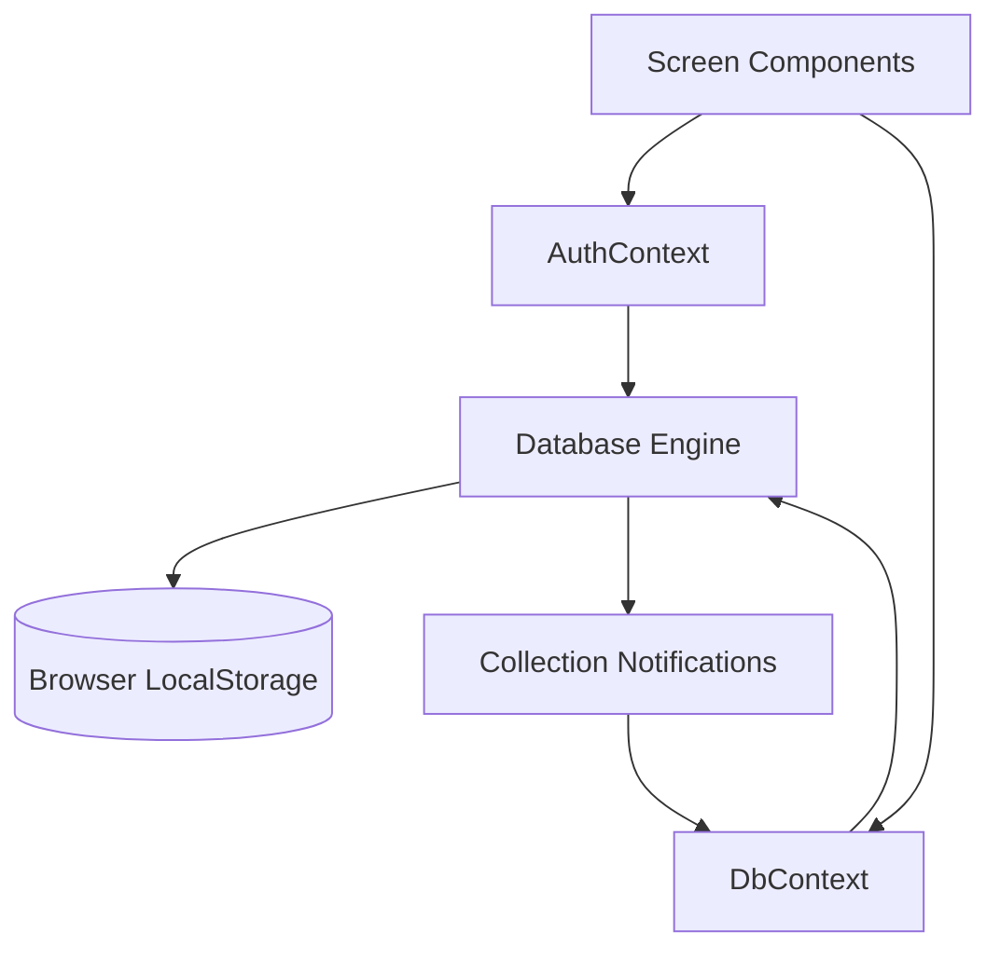

 <h1 align="center">🏪 SmartBiz — Calculator & Business Management</h1>

<p align="center">
  A Practical Point-of-Sale & Small Business Management Application
  <br />
  Simplifying sales, inventory, customer credit, expenses, and business reporting.
</p>

<p align="center">
  
  
  
  
</p>

<p align="center">
  
  
  
</p>

---

## 📑 Table of Contents

* [Overview](#-overview)
* [Features](#-features)
* [Technology Stack](#️-technology-stack)
* [Architecture](#️-architecture)
* [Project Structure](#-project-structure)
* [Prerequisites](#-prerequisites)
* [Installation and Setup](#-installation-and-setup)
* [Usage Guide](#-usage-guide)
* [Data Storage and Backup](#-data-storage-and-backup)
* [Roles and Permissions](#-roles-and-permissions)
* [Security and Limitations](#-security-and-limitations)
* [Testing](#-testing)
* [Deployment](#️-deployment)
* [Troubleshooting](#-troubleshooting)
* [Additional Documentation](#-additional-documentation)
* [Roadmap](#-roadmap)
* [Contributing](#-contributing)
* [License](#-license)
* [Developer](#-developer)

---

## 📌 Overview

**SmartBiz** is a browser-based business management application designed to bring common retail operations into one interface. It combines a business calculator, point-of-sale workflow, inventory management, customer credit records, expenses, and reports.

The application is intended for shopkeepers and small businesses, particularly those following Pakistani retail conventions.

### Key Highlights

* Business calculator with markup and GST operations.
* Quick sales and multi-item billing.
* Customer records and *Udhar* ledger.
* Product, inventory, and supplier management.
* Sales returns and expense tracking.
* Business reports and CSV exports.
* Printable receipts and WhatsApp sharing links.
* Local JSON backup and restore.

> **Current status:** SmartBiz is a frontend prototype. It uses demonstration data and browser LocalStorage. Secure authentication, backend services, cloud synchronization, and automated tests are not currently implemented.

## ✨ Features

### 1. Smart Business Calculator

* Standard arithmetic using keyboard and on-screen input.
* Markup (MU) calculations.
* GST addition and removal.
* Memory functions: M+, M−, and MRC.
* Grand Total (GT) recall.
* Calculation history and category tags.
* Favorites, search, and category filtering.
* Shortcuts for favorite products.
* Transfer calculations into the billing workflow.

### 2. Quick Sale and POS Billing

* Quick checkout for walk-in customers.
* Multi-item shopping cart.
* Product search by name, SKU, or barcode text.
* Item-level and bill-level discounts.
* Configurable tax rate.
* Customer selection and payment entry.
* Invoice status tracking: `paid`, `partial`, or `unpaid`.
* Payment method selection, including cash, card, QR-based payment, bank transfer, and credit options in the data model.

Payment options do not imply that a live payment gateway is integrated.

### 3. Receipts and Sharing

* Printable receipts through the browser print dialog.
* Receipt sizes: 58 mm, 80 mm, and A4.
* Configurable invoice prefix and receipt footer.
* WhatsApp links for sharing receipt information.
* QR payment image generation using a configured payment identifier.

The default invoice prefix is `SB-`. Invoice numbering uses the application's configured prefix and count-based numbering scheme.

### 4. Customers and Udhar Ledger

* Customer directory and records.
* Outstanding balance tracking.
* Customer ledger entries.
* Credit sales and payment settlements.
* WhatsApp payment reminder links.

### 5. Products and Inventory

* Product names, SKUs, and barcode fields.
* Units and categories.
* Purchase, retail, wholesale, and special prices.
* Stock quantities and minimum stock levels.
* Product tax rates and favorites.
* Stock adjustment transactions.
* Damaged-stock write-off reasons.

### 6. Suppliers and Purchases

* Supplier records.
* Purchase record management.
* Supplier purchase tracking.
* Stock updates through supported purchase workflows.

### 7. Sales Returns

* Supported sales-return workflows.
* Restock or non-restock options.
* Cash refund or credit adjustment options.
* Return-related records.

### 8. Expenses and Reports

* Expense entry and category management.
* Dashboard KPIs and business summaries.
* Seven-day area chart and pie chart visualizations.
* Profit and Loss report.
* Daily business summary.
* Customer and supplier dues reports.
* Best-selling products report.
* Cashier performance report.
* CSV export and report printing.

Reports are generated from data available in the browser; they are not backed by a centralized database.

### 9. Settings and Data Management

* Store profile and currency configuration.
* Invoice prefix and receipt settings.
* Tax and payment identifier settings.
* Sound feedback toggle.
* Staff list interface.
* JSON backup export and restore.
* Activity log entries for key transactions.

## 🛠️ Technology Stack

| Technology           | Purpose                                  |
| -------------------- | ---------------------------------------- |
| React 19             | User interface and components            |
| TypeScript           | Application types and type checking      |
| Vite                 | Development server and production builds |
| Tailwind CSS 4       | Styling                                  |
| Lucide React         | Interface icons                          |
| Recharts             | Charts and dashboard visualizations      |
| Browser LocalStorage | Local data persistence                   |
| Web Audio API        | Optional sound feedback                  |
| `window.print()`     | Receipt and report printing              |
| WhatsApp links       | Sharing receipts and reminders           |
| npm / Bun            | Package management                       |

The project review identified `@google/genai`, `express`, `dotenv`, and `motion` as dependencies worth checking for actual usage. The current application does not implement Gemini-powered functionality or an Express backend.

## 🏗️ Architecture

SmartBiz uses a client-side React architecture. Screen components interact with context providers, while the database engine handles LocalStorage operations and collection updates.

### Application Flow



### Main Data Operations

The database engine in `src/services/db.ts` includes methods such as:

* `createInvoice`
* `recordCustomerPayment`
* `createPurchase`
* `processReturn`
* `adjustStock`
* `exportBackup`
* `importBackup`
* `resetToDefaults`

These operations work with browser-stored data rather than a remote database.

## 📂 Project Structure

```text
SmartBiz/
├── index.html
├── package.json
├── vite.config.ts
├── tsconfig.json
├── bun.lock
├── metadata.json
├── .env.example
├── public/
│   └── assets/
│       └── aistudio/
└── src/
    ├── main.tsx
    ├── App.tsx
    ├── index.css
    ├── types/
    │   └── index.ts
    ├── services/
    │   └── db.ts
    ├── context/
    │   ├── AuthContext.tsx
    │   └── DbContext.tsx
    └── components/
        ├── auth/
        ├── layout/
        ├── dashboard/
        ├── calculator/
        ├── pos/
        ├── customers/
        ├── products/
        ├── inventory/
        ├── purchases/
        ├── returns/
        ├── expenses/
        ├── reports/
        └── settings/
```

### Important Files

| File                          | Purpose                                    |
| ----------------------------- | ------------------------------------------ |
| `src/main.tsx`                | React entry point                          |
| `src/App.tsx`                 | Main application and navigation            |
| `src/index.css`               | Styling and print styles                   |
| `src/types/index.ts`          | Domain types                               |
| `src/services/db.ts`          | Local data engine and transactions         |
| `src/context/AuthContext.tsx` | User state, role permissions, and settings |
| `src/context/DbContext.tsx`   | Data access, sound, and backup helpers     |
| `vite.config.ts`              | Vite configuration                         |
| `package.json`                | Dependencies and npm scripts               |

## 📋 Prerequisites

Before installing SmartBiz, make sure you have:

* Node.js LTS compatible with the project's Vite and Tailwind CSS versions.
* npm, included with Node.js.
* Git, recommended for version control.
* A modern browser such as Chrome, Edge, or Firefox.

Bun is also an option because the repository includes a `bun.lock` file.

## 🚀 Installation and Setup

### 1. Clone the Repository

Replace `<repository-url>` with the actual GitHub repository URL.

```bash
git clone <repository-url>
```

### 2. Open the Project Directory

```bash
cd <project-folder>
```

### 3. Install Dependencies

Using npm:

```bash
npm install
```

Alternatively, using Bun:

```bash
bun install
```

### 4. Start the Development Server

```bash
npm run dev
```

Open the local URL shown in the terminal. The supplied Vite configuration uses port `3000` and listens on `0.0.0.0`.

### 5. Check and Build the Application

```bash
npm run lint
npm run build
```

The production build is generated in `dist/`.

## 📖 Usage Guide

On first load, the application initializes demonstration data for **Al-Madina Smart Superstore**, including sample products, customers, suppliers, expenses, and calculations.

| Section           | Purpose                                  |
| ----------------- | ---------------------------------------- |
| Dashboard         | Review business figures and charts       |
| Calculator        | Perform retail calculations              |
| Quick Sale        | Record a walk-in sale                    |
| Billing / POS     | Create invoices and track payment status |
| Customers & Udhar | Manage customer balances and settlements |
| Products          | Manage product details and prices        |
| Inventory         | Adjust stock and record damaged goods    |
| Purchases         | Record supplier purchases                |
| Returns           | Process supported returns                |
| Expenses          | Track operating expenses                 |
| Reports           | Review and export reports                |
| Settings          | Configure the store and manage backups   |

The application provides a demonstration role switcher for Admin, Manager, and Cashier. These roles are not equivalent to secure authentication.

## 💾 Data Storage and Backup

SmartBiz stores its data in browser LocalStorage. Records do not automatically synchronize across browsers or devices.

### Storage Keys

Collections follow this general naming pattern:

```text
smartbiz_biz_main_<collection>
```

Other keys include:

```text
smartbiz_initialized
smartbiz_sound
```

### Main Collections

* `settings`
* `users`
* `products`
* `customers`
* `suppliers`
* `customerLedger`
* `expenses`
* `invoices`
* `purchases`
* `returns`
* `calculations`
* `inventoryTransactions`
* `activityLogs`
* `paymentReminders`

### Backup and Restore

1. Open **Settings**.
2. Find the Backup & Restore section.
3. Export a JSON backup.
4. Save the file somewhere safe.
5. Use the restore option to import a supported backup when needed.

**Important:** Importing a backup overwrites the collections included in the file. Collections missing from the backup are left unchanged. The current import validation is limited and should not be considered comprehensive validation of untrusted files.

Clearing browser storage can permanently delete business records. Always create a backup before resetting data.

## 👤 Roles and Permissions

The application defines three demonstration roles: Admin, Manager, and Cashier.

| Permission         |  Admin  |   Manager   |   Cashier   |
| ------------------ | :-----: | :---------: | :---------: |
| Create sales       |    ✅    |      ✅      |      ✅      |
| Give discounts     |    ✅    |      ✅      |      ✅      |
| Record payments    |    ✅    |      ✅      |      ✅      |
| Manage customers   |    ✅    |      ✅      |      ✅      |
| Cancel sales       | Defined |   Defined   | Not granted |
| View profit        |    ✅    |      ✅      |      ❌      |
| View purchase cost |    ✅    |      ✅      |      ❌      |
| Manage products    |    ✅    |      ✅      |      ❌      |
| Manage suppliers   |    ✅    |      ✅      |      ❌      |
| Manage expenses    |    ✅    |      ✅      |      ❌      |
| View reports       |    ✅    |      ✅      |      ❌      |
| Manage staff       | Defined | Not granted | Not granted |
| Backup and restore | Defined | Not granted | Not granted |

Permission enforcement is incomplete. The supplied review found that the Settings screen does not consistently check the `can()` permission helper, so some controls may remain visible across roles.

Do not rely on these demonstration permissions to protect sensitive information.

## 🛡️ Security and Limitations

SmartBiz is a frontend prototype, not a production-ready business system.

* **Authentication:** The login flow does not validate passwords. Recognized seeded emails select corresponding users; unrecognized emails create a guest session.
* **Permissions:** Role checks are client-side and are not enforced by a backend.
* **Storage:** LocalStorage is not encrypted by the application and can be inspected or modified by someone with access to the browser.
* **QR generation:** The QR dialog sends the generated payment string, including the configured payment identifier, to `api.qrserver.com`.
* **WhatsApp sharing:** Receipt and payment reminder links can open WhatsApp with prepared message text.
* **Demo records:** Seed data includes sample customer information and a sample payment identifier.

Avoid using the prototype to store sensitive real-world customer or financial records until suitable authentication, access controls, secure persistence, and data protection are implemented.

### Current Implementation Status

| Feature                           | Status                                    |
| --------------------------------- | ----------------------------------------- |
| Calculator and billing            | Implemented in frontend                   |
| Customer and inventory management | Implemented in frontend                   |
| Purchases, returns, and expenses  | Implemented in frontend                   |
| Dashboard and reports             | Implemented in frontend                   |
| Local backup and restore          | Implemented in frontend                   |
| Secure authentication             | Not implemented                           |
| Backend API                       | Not implemented                           |
| Cloud synchronization             | Not implemented                           |
| AI functionality                  | Not implemented                           |
| Automated tests                   | Not configured                            |
| Multi-device synchronization      | Not available                             |
| Invoice cancellation UI           | No UI action found in the supplied review |

## 🧪 Testing

The supplied project review found no configured automated test runner or test files.

The available `npm run lint` script performs TypeScript checking using `tsc --noEmit`; it is not a full ESLint run.

Run these commands to check the project:

```bash
npm install
npm run lint
npm run build
```

The results of these commands have not been independently verified for this README. Resolve any errors before deployment.

## ☁️ Deployment

SmartBiz can be deployed as a static website because its current functionality runs in the browser.

### Build for Production

```bash
npm install
npm run build
```

Configure your static hosting provider to publish the generated `dist/` directory.

A separate backend is not required for the current frontend prototype. However, each browser maintains its own LocalStorage data.

No verified deployment URL, CI workflow, or Docker configuration has been provided for this documentation.

**For real business use:** Implement secure authentication, server-side authorization, reliable database storage, backups, and appropriate data protection before relying on the application for business-critical operations.

## 🔧 Troubleshooting

| Problem                           | Suggested solution                                                                   |
| --------------------------------- | ------------------------------------------------------------------------------------ |
| Dependency installation fails     | Check Node.js compatibility and review the npm error.                                |
| Development server will not start | Confirm dependencies installed successfully and inspect the terminal output.         |
| Port `3000` is busy               | Stop the conflicting process or try `npx vite --port 3001`.                          |
| Business data disappears          | Check browser storage and the active browser profile. Restore a backup if available. |
| Demo data is incorrect            | Export important records before resetting any LocalStorage data.                     |
| QR image does not load            | Check connectivity to the external QR image service.                                 |
| Receipt printing looks incorrect  | Check the receipt print action and browser print settings.                           |

Never clear LocalStorage without first backing up any important records.

## 📚 Additional Documentation

The repository documentation list includes:

| File                                | Description                |
| ----------------------------------- | -------------------------- |
| `ARCHITECTURE.md`                   | System architecture        |
| `API.md`                            | API-related documentation  |
| `DATABASE.md`                       | Data model and persistence |
| `FIREBASE.md`                       | Firebase-related guidance  |
| `SETUP.md`                          | Development setup          |
| `DEVELOPMENT.md`                    | Development workflow       |
| `DEPLOYMENT.md`                     | Deployment guidance        |
| `TESTING.md`                        | Testing guidance           |
| `SECURITY.md`                       | Security considerations    |
| `PROJECT_STRUCTURE.md`              | Project organization       |
| `AUTHENTICATION_AND_PERMISSIONS.md` | Roles and access control   |
| `CALCULATOR_AND_BILLING.md`         | Calculator and billing     |
| `INVENTORY_AND_PURCHASES.md`        | Inventory and purchases    |
| `BUSINESS_INTELLIGENCE.md`          | Business reporting         |
| `CHANGELOG.md`                      | Change history             |
| `CONTRIBUTING.md`                   | Contribution guidance      |
| `ROADMAP.md`                        | Planned improvements       |

These files have not all been audited line by line for this README. Check the relevant source code before treating planned backend, Firebase, AI, or testing capabilities as implemented.

## 🗺️ Roadmap

Planned improvements include:

* [ ] Implement secure authentication.
* [ ] Enforce permissions consistently.
* [ ] Add a backend and cloud database.
* [ ] Enable multi-device synchronization.
* [ ] Add unit and integration tests.
* [ ] Implement and test invoice cancellation.
* [ ] Expand business reporting and analytics.
* [ ] Explore payment-provider integrations.
* [ ] Add multi-store support.
* [ ] Explore customer loyalty features.
* [ ] Evaluate AI-assisted demand forecasting.
* [ ] Review and remove unused dependencies.

These items are proposed improvements, not current features.

## 🤝 Contributing

Contributions, bug reports, and suggestions are welcome.

1. Fork the repository.
2. Create a feature branch.
3. Install dependencies.
4. Make focused changes consistent with the existing project structure.
5. Run the available type check and production build.
6. Update relevant documentation.
7. Submit a pull request explaining your changes.

Example workflow:

```bash
git checkout -b feature/your-feature
npm install
npm run dev
npm run lint
npm run build
git add .
git commit -m "Add: describe your changes"
git push origin feature/your-feature
```

See `CONTRIBUTING.md` for additional project-specific guidance.

## 📄 License

No `LICENSE` file or explicit source-code license has been verified in the supplied project information.

Until a license is added, do not assume that the repository grants permission to redistribute or reuse its code. Choose an appropriate license and add the corresponding file when ready.

## 👨‍💻 Developer

<p align="center">
  <strong>Developed by Youza Ahsan</strong>
  <br />
  <a href="https://github.com/youzaahsan">GitHub Profile</a>
  &nbsp;•&nbsp;
  <a href="https://youzaahsan.github.io/">Portfolio</a>
</p>

---

<p align="center">
  <strong>🏪 SmartBiz — Simplifying Everyday Business Management</strong>
  <br />
  Built with React, TypeScript, Vite, and modern frontend technologies.
</p>
