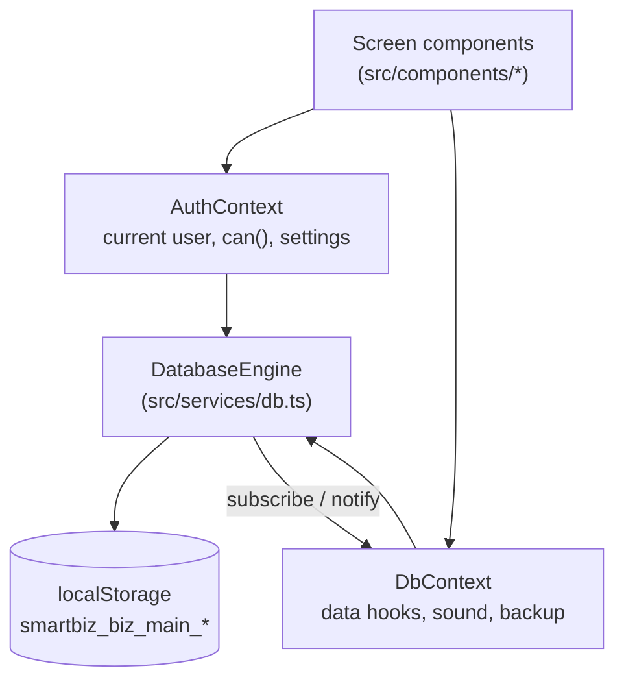
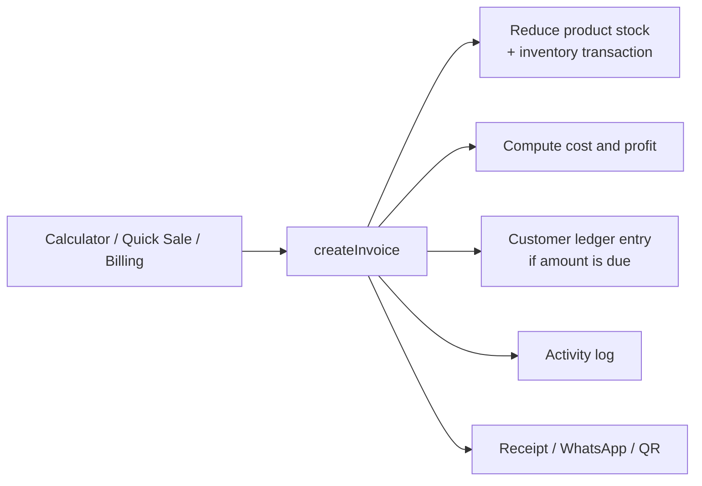

# SmartBiz Calculator & Business Management

A browser-based point-of-sale and small-business management app built with React, TypeScript and Vite. It combines a business calculator with billing, customer credit (*Udhar*) ledgers, inventory, supplier purchases, returns, expenses and basic profit-and-loss reporting. All data is stored locally in the browser; there is no backend or cloud sync in the current code.

**Intended users:** shopkeepers and small retail businesses (the seed data and defaults use Pakistani Rupees, *Udhar* terminology, and EasyPaisa/WhatsApp conventions).

**Project status:** working front-end prototype with seeded demo data. Cloud sync, real authentication and automated tests are not implemented (see [Limitations](#current-status-and-limitations)).

## Table of Contents

- [Overview](#overview)
- [Features](#features)
- [Screenshots and Demo](#screenshots-and-demo)
- [Technology Stack](#technology-stack)
- [Architecture and Workflow](#architecture-and-workflow)
- [Project Structure](#project-structure)
- [Prerequisites](#prerequisites)
- [Installation and Setup](#installation-and-setup)
- [Environment Variables and Configuration](#environment-variables-and-configuration)
- [Running the Application](#running-the-application)
- [Usage Guide](#usage-guide)
- [Data and Persistence](#data-and-persistence)
- [Roles and Permissions](#roles-and-permissions)
- [Security and Privacy](#security-and-privacy)
- [Testing and Code Quality](#testing-and-code-quality)
- [Deployment](#deployment)
- [Troubleshooting](#troubleshooting)
- [Current Status and Limitations](#current-status-and-limitations)
- [Roadmap](#roadmap)
- [Additional Documentation](#additional-documentation)
- [Contributing](#contributing)
- [License](#license)

## Overview

Small shops often juggle a handheld calculator, a paper credit register and a separate stock book. SmartBiz puts these in one single-page app:

1. Calculate on a business calculator (markup, GST add/remove, memory, grand total) and keep a categorized tape of calculations.
2. Turn a calculation into a bill, or sell directly through Quick Sale or the full Billing screen.
3. Record unpaid or partly paid sales against a customer's *Udhar* (credit) balance and settle it later.
4. Keep product stock, supplier purchases, returns and expenses consistent with each other.
5. Review sales, profit and outstanding balances on the dashboard and reports.

## Features

### Implemented (verified in source)

**Smart Calculator** (`SmartCalculator.tsx`)
- Arithmetic with keyboard and on-screen input, plus markup (MU), grand total (GT) recall, memory (M+, M-, MRC), and GST add/remove with a configurable rate.
- Tape of past calculations with category tags, favorites, search and category filtering.
- Favorite products bar, "convert to bill" and "save to customer" actions that hand the amount to the Billing screen.

**Selling**
- *Quick Sale* (`QuickSale.tsx`): single-screen walk-in checkout with payment method selection.
- *Billing / POS* (`BillingView.tsx`): multi-item cart, per-line discounts, bill-level discount, tax rate, paid amount with automatic `paid` / `partial` / `unpaid` status, customer selection, product search by name, SKU or barcode text, and an invoice list with status filtering.
- Payment methods in the data model: `cash`, `card`, `upi_qr`, `bank_transfer`, `credit`.
- Receipts (`ThermalReceipt.tsx`) printed through the browser's print dialog, with 58mm, 80mm or A4 selectable in Settings, and a WhatsApp share link.
- QR payment dialog (`QrPaymentModal.tsx`) built from the store's payment identifier (see [Security and Privacy](#security-and-privacy) for an external-request note).
- Invoice numbers are generated as `<prefix><1001 + count>` (default prefix `SB-`).

**Customers and Udhar** (`CustomerManagement.tsx`)
- Customer directory, balance tracking, ledger entries, payment settlement, and a WhatsApp reminder message opened through a `wa.me` link.

**Products, inventory and purchases**
- Products with SKU, barcode, unit, category, purchase / retail / wholesale / special price, stock, minimum stock, tax rate and favorite flag.
- Stock adjustments, including a "damaged" reason, recorded as inventory transactions.
- Suppliers and purchase orders that update stock.

**Returns and expenses**
- Sale returns with a restock option and a refund method of cash or credit adjustment.
- Expense log with categories.

**Dashboard and reports**
- Dashboard KPIs and Recharts charts (area chart of the last 7 days, pie chart).
- Reports: Profit & Loss, daily summary, customer dues, supplier dues, best sellers, cashier performance, with CSV export and print.

**Settings and data**
- Store profile, currency, invoice prefix, receipt footer, paper size, payment identifier, sound toggle, staff list, JSON backup export and restore.
- Optional synthesized sound feedback through the Web Audio API.
- Activity log entries for key transactions.

### Not implemented in code
Cloud/Firebase sync, real authentication, AI features, a backend API, invoice cancellation from the UI, and automated tests. See [Roadmap](#roadmap).

## Screenshots and Demo

The repository contains no screenshots, recordings or live demo URL. Add images under a folder such as `docs/screenshots/` and reference them here once available.

## Technology Stack

Only technologies that are imported or configured by the source are listed as active.

| Category | Technology | Notes |
|---|---|---|
| Language | TypeScript | `tsconfig.json`, `noEmit` type-check |
| UI | React 19 (`react`, `react-dom`) | Single-page app, `StrictMode` |
| Build tool | Vite with `@vitejs/plugin-react` | Dev server on port 3000 |
| Styling | Tailwind CSS 4 via `@tailwindcss/vite` | `@import "tailwindcss"` in `src/index.css` |
| Icons | `lucide-react` | Used in 17 source files |
| Charts | `recharts` | Used in the dashboard |
| Persistence | Browser `localStorage` | Custom `DatabaseEngine` in `src/services/db.ts` |
| Browser APIs | Web Audio API, `window.print()`, `wa.me` links | |
| Package manager | `bun.lock` is committed | npm also works with `package.json` |

**Declared but not used by any file in `src/`:** `@google/genai`, `express`, `dotenv`, `motion`. They can be removed or are reserved for future work; the app does not call Gemini or run an Express server today.

## Architecture and Workflow

The app is a client-only React tree. Context providers expose the database engine and the current user to the screens; the engine reads and writes `localStorage` and notifies subscribers when a collection changes.



Main sale flow, as implemented in `createInvoice`:



The engine's transactional methods are `createInvoice`, `recordCustomerPayment`, `createPurchase`, `processReturn` and `adjustStock`; backup helpers are `exportBackup`, `importBackup` and `resetToDefaults`.

## Project Structure

```text
.
├── index.html                 # Vite entry HTML
├── package.json               # Scripts and dependencies
├── vite.config.ts             # React + Tailwind plugins, "@" alias
├── tsconfig.json
├── bun.lock
├── metadata.json              # AI Studio applet metadata
├── .env.example               # Declared variables (not read by src/)
├── public/assets/aistudio/    # Placeholder folder (.gitignore only)
├── src/
│   ├── main.tsx               # React root
│   ├── App.tsx                # Tab navigation and calculator-to-billing handoff
│   ├── index.css              # Tailwind import and print rules
│   ├── types/index.ts         # Domain types (User, Product, Invoice, ...)
│   ├── services/db.ts         # DatabaseEngine, seed data, transactions
│   ├── context/
│   │   ├── AuthContext.tsx    # Current user, role permissions, settings
│   │   └── DbContext.tsx      # Data access, sound effects, backup helpers
│   └── components/
│       ├── auth/              # AuthModal (role switcher / sign-in form)
│       ├── layout/            # AppNavbar
│       ├── dashboard/         # DashboardOverview
│       ├── calculator/        # SmartCalculator, SaveToCustomerModal
│       ├── pos/               # QuickSale, BillingView, ThermalReceipt, QrPaymentModal
│       ├── customers/         # CustomerManagement
│       ├── products/          # ProductManagement
│       ├── inventory/         # InventoryManagement
│       ├── purchases/         # PurchaseManagement
│       ├── returns/           # ReturnManagement
│       ├── expenses/          # ExpenseManagement
│       ├── reports/           # BusinessReports
│       └── settings/          # SettingsView
└── *.md                       # Additional documentation (see below)
```

## Prerequisites

- **Node.js and npm** (or Bun, since `bun.lock` exists). The repository does not pin a Node version (`engines` and `.nvmrc` are absent); the current Vite and Tailwind 4 toolchain needs a recent Node release, so use an actively supported LTS version. This was not verified by a local install.
- A modern desktop or mobile browser.
- Internet access only for the optional QR image (see [Security and Privacy](#security-and-privacy)).

## Installation and Setup

```bash
# 1. Get the project (replace <repository-url> with your repository)
git clone <repository-url>
cd <project-folder>

# 2. Install dependencies
npm install
# or: bun install
```

No database, migration or service setup is required. Demo data is created automatically in the browser on first load.

## Environment Variables and Configuration

`.env.example` declares two variables, but **no file in `src/` or `vite.config.ts` reads them**, so the app runs without a `.env` file.

| Variable | Declared purpose | Used by code? |
|---|---|---|
| `GEMINI_API_KEY` | Gemini API key (AI Studio injects it) | No |
| `APP_URL` | Hosting URL (AI Studio injects it) | No |

`vite.config.ts` also reads `DISABLE_HMR` (set to `true` to turn off hot reload and file watching, a setting used inside AI Studio). `.env*` files are git-ignored except `.env.example`; never commit real keys.

Business configuration (store name, currency, invoice prefix, tax, paper size, payment identifier) is edited in the app under **Settings** and saved to `localStorage`.

## Running the Application

```bash
npm run dev       # Vite dev server on http://localhost:3000 (host 0.0.0.0)
npm run build     # Production build to dist/
npm run preview   # Serve the production build locally
npm run lint      # tsc --noEmit (type check only)
```

`npm run clean` removes `dist` and `server.js`; no `server.js` exists in this repository.

## Usage Guide

On first load the app seeds a demo store ("Al-Madina Smart Superstore") with 8 products, 4 customers, 2 suppliers, 3 expenses and a few calculations. The top navigation provides these tabs:

| Tab | What you can do |
|---|---|
| Dashboard | See today's figures, the 7-day chart and shortcuts |
| Calculator | Calculate, apply MU / GST / memory, convert the result to a bill or save it to a customer |
| Quick Sale | Add products to a quick cart and complete a walk-in sale |
| Billing / POS | Build a detailed bill, set discounts, tax and paid amount, print or share the receipt; browse past invoices |
| Customers & Udhar | Search customers, view ledger, settle dues, send a WhatsApp reminder |
| Products | Add or edit products and prices (cost price hidden for cashiers) |
| Inventory | Adjust stock or write off damaged goods |
| Purchases | Record supplier purchases and manage suppliers |
| Returns | Process a sale return with restock and refund options |
| Expenses | Log and review operating expenses |
| Reports | P&L, daily, dues, best sellers, cashier performance; export CSV or print |
| Settings | Store profile, receipts and QR identifier, staff, backup and restore |

Use the user control in the header to open the role switcher and change between the seeded Admin, Manager and Cashier accounts.

## Data and Persistence

- All data lives in the browser's `localStorage`, under keys of the form `smartbiz_biz_main_<collection>`, plus `smartbiz_initialized` and `smartbiz_sound`.
- Collections: `settings`, `users`, `products`, `customers`, `suppliers`, `customerLedger`, `expenses`, `invoices`, `purchases`, `returns`, `calculations`, `inventoryTransactions`, `activityLogs`, `paymentReminders`.
- Data is per browser and per device. Clearing site data deletes it.
- **Backup:** Settings, Backup & Restore tab, "Download Backup File" saves a JSON snapshot; restoring a file overwrites every collection contained in the file (collections absent from it are left as they are) and only checks that the file has a `data` object.
- `resetToDefaults()` exists in the engine and re-seeds the demo data.

## Roles and Permissions

Permissions are defined in `ROLE_PERMISSIONS` in `AuthContext.tsx`:

| Permission | Admin | Manager | Cashier |
|---|:---:|:---:|:---:|
| create_sale, give_discount, record_payments, manage_customers | Yes | Yes | Yes |
| cancel_sale, view_profit, view_purchase_cost, manage_products, manage_suppliers, manage_expenses, view_reports | Yes | Yes | No |
| manage_staff, backup_restore | Yes | No (not granted) | No |

Where the UI actually checks these (verified): the Reports tab is hidden without `view_reports`; product cost price is hidden without `view_purchase_cost`; product edit controls need `manage_products`; an expense action needs `manage_expenses`; the dashboard profit tile needs `view_reports`. I found no `can(...)` check in the Settings screen, so staff and backup controls are visible to every role, and `cancel_sale` / `manage_staff` / `backup_restore` are defined but not enforced in the UI.

## Security and Privacy

- **There is no real authentication.** `login()` accepts any email: a known seeded email selects that user, otherwise a guest session is created, and the password argument is ignored. The role switcher changes role in one click. Treat roles as a convenience for demos, not as access control.
- Permissions are enforced only in client-side UI; anyone with browser access can read or edit `localStorage`.
- Data is stored unencrypted in the browser.
- The QR dialog loads an image from `https://api.qrserver.com`, sending the generated payment string (including the store's payment identifier) to that third-party service.
- Receipts and reminders open `wa.me` links, which hand message text to WhatsApp when the user clicks.
- Seed data contains sample names, phone numbers and a sample payment identifier. Replace them before real use.
- Keep API keys and `.env` files out of version control (`.gitignore` already excludes `.env*` except `.env.example`).

## Testing and Code Quality

- No test files, test runner or test script exist in the repository.
- The only quality script is `npm run lint`, which runs `tsc --noEmit`.
- **Executed while preparing this README:** none. The sandbox had no network access, so dependencies could not be installed and neither the type check nor the build was run. Run `npm install && npm run lint && npm run build` locally to confirm.

## Deployment

The repository has no deployment configuration (no Dockerfile, CI workflow, or hosting config). `npm run build` produces static files in `dist/`, which a static host can serve; because the app is client-only and keeps data in each visitor's browser, no server component is required. `metadata.json` indicates the project was generated in Google AI Studio. Hosting specifics beyond the build step are not defined here.

## Troubleshooting

| Problem | Likely cause and fix |
|---|---|
| `npm install` or dev server fails on startup | Node.js may be too old for the current Vite / Tailwind 4 / TypeScript versions. Upgrade to a current LTS release. |
| Port 3000 already in use | Stop the other process or run `npx vite --port=3001`. |
| Data disappeared | Browser site data was cleared or a different browser or profile is in use. Restore from a JSON backup. |
| Demo data looks outdated or broken | Clear the `smartbiz_*` keys in browser storage and reload to re-seed. |
| QR image does not load | The QR image comes from an external service; check internet access. |
| Print shows the whole page | Use the receipt's print action; print styles hide everything except the `.printable-thermal` element. |

## Current Status and Limitations

| Area | Status |
|---|---|
| Calculator, Quick Sale, Billing, Customers, Products, Inventory, Purchases, Returns, Expenses, Reports, Settings | Implemented (not covered by automated tests) |
| Roles and permissions | Partially implemented: UI-level only, several permissions unenforced |
| Authentication | Not implemented (role switcher with no password check) |
| Cloud sync / Firebase | Not implemented; design only in `FIREBASE.md` |
| AI features | Not implemented, although `@google/genai` is a dependency |
| Invoice cancellation | A `cancelled` status exists in the types, but no UI action was found |
| Automated tests | None |
| Multi-device or multi-user data sharing | Not possible (browser-local storage) |

## Roadmap

Planned items listed in `ROADMAP.md` (not implemented): cloud synchronization, hardware integration, multi-store support, loyalty features, AI demand forecasting and banking integrations. Suggested near-term hygiene work: add real authentication, enforce the defined permissions in Settings, add tests for the `DatabaseEngine` transactions, and remove unused dependencies.

## Additional Documentation

The repository includes `ARCHITECTURE.md`, `API.md`, `DATABASE.md`, `FIREBASE.md`, `SETUP.md`, `DEVELOPMENT.md`, `DEPLOYMENT.md`, `TESTING.md`, `SECURITY.md`, `PROJECT_STRUCTURE.md`, `AUTHENTICATION_AND_PERMISSIONS.md`, `CALCULATOR_AND_BILLING.md`, `INVENTORY_AND_PURCHASES.md`, `BUSINESS_INTELLIGENCE.md`, `CHANGELOG.md`, `CONTRIBUTING.md` and `ROADMAP.md`. These were not audited line by line for this README; where they describe cloud, Firebase, server or test setups, treat them as plans unless the code above confirms them. This README reflects the source code.

## Contributing

1. Fork or clone the repository and create a feature branch.
2. Run `npm install`, then `npm run dev`.
3. Follow the existing structure (one folder per feature under `src/components`, business logic in `src/services/db.ts`).
4. Run `npm run lint` before committing.
5. Update this README or the relevant document when behavior changes.
6. Open a pull request. See `CONTRIBUTING.md` for the project's own notes.

## License

No `LICENSE` file is present in the repository, and no license header was found in the source, so no explicit license has been granted. (An earlier version of this README stated Apache-2.0, which could not be verified.) Add a `LICENSE` file and update this section once you choose a license.
